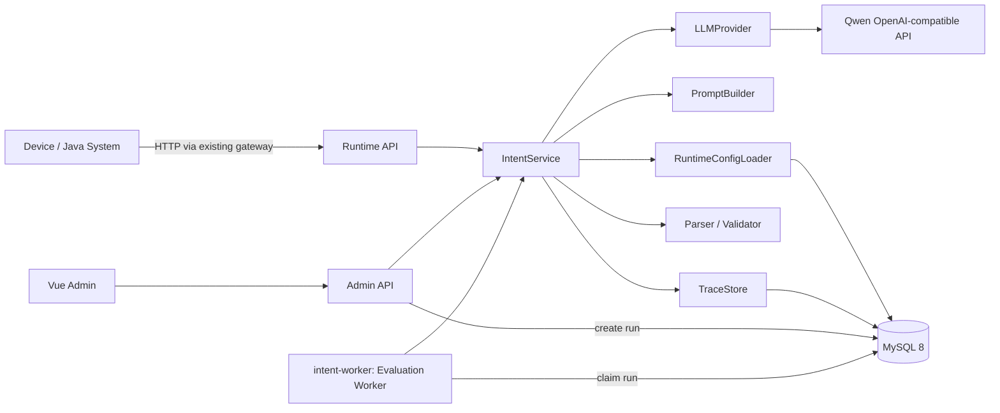

# 02 系统架构设计

## 1. 总体架构



## 2. IntentService Pipeline

一期采用普通确定性 Service Pipeline：

```text
normalize request
-> load release + effective model config
-> build final prompt/messages
-> invoke provider
-> parse structured output
-> pydantic/business validate
-> build runtime result
-> persist trace
```

不引入 Graph state/node/edge。未来出现 Safety Guard、ASR、多轮 clarification、工具调用等多节点状态流程后再评估 LangGraph。

## 3. Runtime 与 Admin 边界

### Runtime

- `POST /api/v1/intent/analyze`
- `GET /health`
- `GET /ready`

只返回稳定 Runtime Contract。

### Admin

- Config Draft/Release
- Debug
- Trace
- Replay/Diff
- Evaluation
- Service Status

Admin API 可以返回研发调试信息，但部署层必须限制只从内部研发入口访问。

## 4. 核心模块

### RuntimeConfigLoader

读取 `runtime_state.active_release_id`，加载不可变 Snapshot。支持短 TTL cache；每次 cache refresh 都检查 active release id，避免多 Pod 长时间使用旧配置。

### PromptBuilder

纯函数优先：同一 Snapshot + 同一 input/context 应生成相同 Prompt 内容和 hash。

### LLMProvider

上层只感知统一请求/响应，不感知 OpenAI SDK/Qwen 细节。Provider 负责 timeout、retry、并发限制、attempt metadata 和 typed error。

### Validator

- Pydantic 结构校验
- route 是否存在于当前 Snapshot
- intent 是否属于已启用定义
- confidence 0..1
- slot span
- clarification 字段组合
- risk 结构

### TraceStore

请求级 + Attempt 级。Trace 不是普通日志，必须能够定位差异首次发生在哪一层。

### Evaluation Worker

作为独立 `intent-worker` Deployment 运行（与 intent-api 同镜像、不同启动命令）。使用 MySQL 作为任务状态来源：

```text
QUEUED -> RUNNING -> SUCCEEDED / FAILED / CANCELLED
```

Worker claim Run 后逐 Case 执行；结果幂等写入。进程异常后根据 heartbeat/stale timeout 恢复。

## 5. 不引入 Redis 的生产策略

- Runtime Config：DB active id + 短 TTL cache。
- Evaluation queue：MySQL row claim。
- 不存会话状态。
- 不做跨请求 Memory。

这样一期支持多副本，又不增加 Redis/MQ 运维依赖。

## 6. 未来扩展边界

二期可在不改变 Runtime Contract 的前提下加入：

- ASR/多模态文本化
- Safety PreRouter
- Redis conversation state
- PlatformClient
- LangGraph workflow
